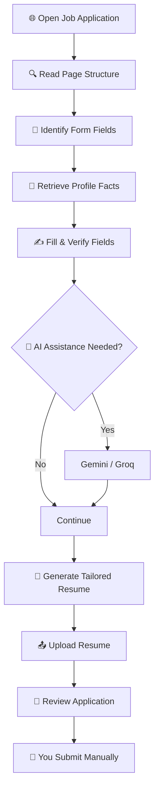

# ⚡ ApplyPilot AI

<h3 align="center">Your job applications. On autopilot. Almost.</h3>

<p align="center">
  <b>An open-source AI-powered Chrome extension that makes applying for jobs faster, smarter, and less repetitive.</b>
</p>

<p align="center">
  
  
  
</p>

<p align="center">
  <a href="https://github.com/giri-harsh/Apply-Pilot/stargazers"></a>
  <a href="https://github.com/giri-harsh/Apply-Pilot/network/members"></a>
  <a href="https://github.com/giri-harsh/Apply-Pilot/issues"></a>
</p>

<p align="center">
  <a href="#-get-started">Get Started</a> •
  <a href="#-features">Features</a> •
  <a href="#-roadmap">Roadmap</a> •
  <a href="#-contribute">Contribute</a>
</p>

---

> [!WARNING]
> **This project is NOT finished.**
>
> ApplyPilot currently handles approximately **80% of its intended functionality in tested scenarios**. It is still under active development and is not production-ready. Real-world portal compatibility, browser verification, and edge cases need further work.
>
> **We are looking for developers to help finish it.** Test it, break it, fix it, and build with us.

## 💡 The Problem

Applying for jobs is repetitive.

- Same personal information.
- Same education details.
- Same experience fields.
- Different application portals.
- Endless resume customisation.

What if your browser could handle most of that work?

## 🚀 Meet ApplyPilot

ApplyPilot is a personal Chrome Extension (Manifest V3) that reads job application pages, intelligently fills fields using your profile, generates job-specific resumes, and uploads them where supported.

**One click to prepare an application. You review and submit it yourself.**

## ✨ Features

<table>
<tr>
<td width="50%">

### 🪄 Smart Autofill

- Reads application forms.
- Uses your local profile vault.
- Tracks provenance for personal facts.
- Verifies fields after filling.
- Reports completed and skipped fields.

</td>
<td width="50%">

### 🔄 Multi-Step Navigation

- Handles supported multi-step forms.
- Identifies recognised Next buttons.
- Navigates application stages.
- Stops before final submission.

</td>
</tr>
<tr>
<td width="50%">

### 🧠 AI-Powered Assistance

- Gemini and Groq support.
- Intelligent field classification.
- Context-grounded answers.
- AI-generated content flagged for review.
- Disabled by default.

</td>
<td width="50%">

### 📄 Resume Intelligence

- Import PDF, DOCX and TXT resumes.
- Maintain a master resume.
- Generate tailored one-page PDFs.
- Preserve factual accuracy.
- Optional cover letters.

</td>
</tr>
<tr>
<td width="50%">

### 🔍 Portal Capture

- Redacted structural snapshots.
- Local capture storage.
- Manual export.
- Helps developers build portal adapters.

</td>
<td width="50%">

### 🛡️ Safety First

- No automatic application submission.
- No fabricated personal information.
- CAPTCHA and MFA detection.
- Execution limits and cancellation.
- API keys excluded from logs and exports.

</td>
</tr>
</table>

## 🔐 Your Applications. Your Control.

ApplyPilot is designed around one non-negotiable rule:

**It prepares applications. It NEVER submits them.**

| Action | ApplyPilot |
|---|---|
| Read job application pages | ✅ |
| Fill verified information | ✅ |
| Generate tailored resumes | ✅ |
| Upload supported resumes | ✅ |
| Navigate recognised form steps | ✅ |
| Click Apply / Submit / Send | ❌ |
| Fill sensitive or consent fields | ❌ |
| Bypass CAPTCHA or MFA | ❌ |

You always get the final say.

## 🏗️ How It Works



## 🛠️ Tech Stack

<p>
  
  
  
  
  
  
  
  
</p>

## 📊 Development Roadmap

ApplyPilot is actively evolving. Here's where the project stands.

| Area | Status |
|---|---|
| Profile vault and autofill | ✅ Implemented |
| Multi-step navigation | ✅ Implemented |
| AI integration | ✅ Implemented |
| Resume tailoring | ✅ Implemented |
| PDF generation | ✅ Implemented |
| Portal capture | ✅ Implemented |
| Synthetic E2E testing | ✅ Implemented |
| Manual real-Chrome validation | 🟡 Pending |
| Real-world portal adapters | 🟡 In progress |
| Production readiness | 🔴 Not ready |

> [!NOTE]
> These are implementation statuses, not independently verified real-world success rates. Check [PROGRESS.md](docs/PROGRESS.md) for the detailed status.

## 🧑‍💻 Get Started

### Prerequisites

- Node.js
- pnpm
- Google Chrome
- Git

### Installation

```bash
# Clone the repository
git clone https://github.com/giri-harsh/Apply-Pilot.git

# Enter the project
cd Apply-Pilot

# Install dependencies
pnpm install

# Build the extension
pnpm build
```

### Load in Chrome

1. Visit `chrome://extensions/`.
2. Enable Developer Mode.
3. Select **Load unpacked**.
4. Choose the `dist/` directory.
5. Configure your profile in Settings.
6. Open a job application page.
7. Click ApplyPilot.

📖 [Read the full installation guide](docs/installation.md).

## ⚙️ Developer Commands

| Command | Purpose |
|---|---|
| `pnpm build` | Build extension |
| `pnpm package` | Create distributable ZIP |
| `pnpm typecheck` | TypeScript validation |
| `pnpm lint` | Lint checks |
| `pnpm test` | Unit tests |
| `pnpm test:e2e` | Playwright E2E tests |
| `pnpm metrics` | Synthetic test metrics |
| `pnpm test:live` | Real API tests (opt-in) |

For Playwright:

```bash
pnpm exec playwright install chromium
```

## 🗺️ Roadmap

Our goal is to move from a working prototype to a reliable, community-tested product.

- [x] Build the core Chrome extension.
- [x] Implement profile-based autofill.
- [x] Integrate optional LLM assistance.
- [x] Implement resume tailoring.
- [x] Build synthetic testing infrastructure.
- [ ] Complete manual Chrome verification.
- [ ] Collect real-world portal captures.
- [ ] Develop and test portal-specific adapters.
- [ ] Improve edge-case handling.
- [ ] Expand integration and regression testing.
- [ ] Work towards production readiness.

**Want to help complete one of these? Pick an issue and open a PR.**

## 🤝 Contribute

### This is where YOU come in.

ApplyPilot is not a finished product. There are bugs, unsupported portals, edge cases, and features waiting to be improved.

We want developers who enjoy building things that actually solve problems.

**Areas where you can contribute:**

| Area | What you can build |
|---|---|
| 🌐 Browser Automation | Real job portal adapters |
| 🧠 AI / ML | Better field classification and answer generation |
| ⚙️ Backend / TypeScript | Better architecture and reliability |
| 📄 Document Processing | Resume parsing and PDF improvements |
| 🧪 Testing | Real-world testing and regression tests |
| 🔒 Security | Privacy and security improvements |
| 🎨 UI / UX | Better extension experience |
| 📚 Documentation | Setup guides and developer documentation |

### How to contribute

1. Fork this repository.
2. Clone your fork.
3. Create a feature branch.
4. Make your changes.
5. Run the relevant tests.
6. Submit a Pull Request.

```bash
git checkout -b feature/your-feature
git add .
git commit -m "feat: describe your contribution"
git push origin feature/your-feature
```

Then open a Pull Request.

<details>
<summary><b>💡 First time contributing? Start here</b></summary>

You don't need to be an expert to contribute.

Start with:

- Finding an existing bug.
- Improving documentation.
- Adding a test case.
- Testing a job portal.
- Fixing a small UI issue.

Look through [open issues](https://github.com/giri-harsh/Apply-Pilot/issues) and pick something interesting.

If you have an idea but cannot find an issue for it, open one first.

</details>

<details>
<summary><b>🧪 Testing and known limitations</b></summary>

- Real Chrome permission prompts and toolbar workflows need manual validation.
- No real-world portal adapters are currently available.
- Closed Shadow DOM and cross-origin iframe contents are unsupported.
- Custom widgets are limited to ARIA-annotated comboboxes and listboxes.
- Scanned resumes do not support OCR.
- Some non-Latin characters may fail PDF validation.
- Gemini currently uses prompt-only schema mode.
- API keys are stored in `chrome.storage.local` without encryption.
- Metrics are based on synthetic fixtures, not actual portal success rates.

See [Security](docs/security.md), [Testing](docs/testing.md), and [Progress](docs/PROGRESS.md).

</details>

<details>
<summary><b>📚 Explore the documentation</b></summary>

- [Specification](docs/SPEC.md)
- [Architecture](docs/architecture.md)
- [Data Models](docs/data-models.md)
- [Security](docs/security.md)
- [Permissions](docs/PERMISSIONS.md)
- [Testing](docs/testing.md)
- [Technical Decisions](docs/DECISIONS.md)
- [Development Progress](docs/PROGRESS.md)
- [Metrics](docs/METRICS.md)

</details>

---

## ⭐ Support the Project

If you find the idea interesting:

1. ⭐ Star this repository.
2. 🐛 Report bugs.
3. 💡 Suggest improvements.
4. 🔧 Contribute code.
5. 📢 Share it with developers.

Every contribution matters.

<p align="center">
  <h2 align="center">Let's make job applications less painful.</h2>
  <p align="center">
    <b>80% of the way there. Let's build the remaining 20% together.</b>
  </p>
  <p align="center">
    <a href="https://github.com/giri-harsh/Apply-Pilot">
      
    </a>
    <a href="https://github.com/giri-harsh/Apply-Pilot/issues">
      
    </a>
  </p>
</p>

**Built with curiosity. Improved by the community.**